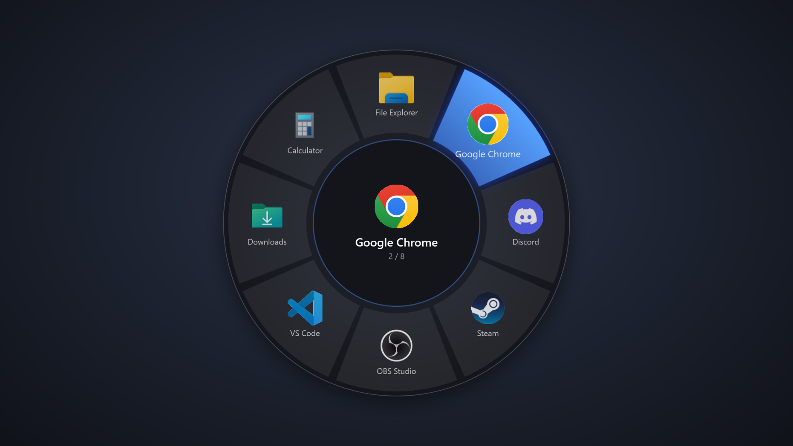

# Dial App Launcher for Stream Deck

Turn a Stream Deck + dial and a launcher wheel appears on your screen. Rotate to choose an app, press to open it.

Open apps, games, files, folders, Store apps and websites from one dial. You can also put the wheel on a key of any Stream Deck model and pick with the mouse or keyboard.

## On a dial (Stream Deck +)
- **Rotate:** brings up the wheel, then moves the selection
- **Press:** brings up the wheel; when it is open, opens the selected item
- **Tap the touch strip:** same as press
- **Hold the touch strip:** closes the wheel

The touch strip shows the icon and name of the selected item.

## On a key
- **Press:** shows or hides the wheel, then pick with the mouse or keyboard

## In the wheel
- **Mouse:** point at an item to select it, click to open it, scroll to move
- **Keyboard:** arrow keys or Tab to move, Enter to open, Esc to close, 1–9 to open item 1–9

The wheel closes on its own after a few seconds without input (you can change this or turn it off), when you click somewhere else, or with Esc. When it closes without opening anything, the window you were using gets the focus back.

## What you can open
- **Apps and games:** pick an .exe or a shortcut, or choose from the list of installed apps (Store apps and Steam games included)
- **Files:** documents, images, scripts… they open in their default app
- **Folders:** open in File Explorer
- **Websites and links:** `https://…`, `steam://…`, `discord://…`, `ms-settings:` and other links

Icons are picked up from the apps and files themselves.

## Settings
- **Items:** add with *App or file*, *Installed app*, *Folder* or *Website or link*, reorder with ▲ ▼, and test each one with ▶. Every item has a name (leave it empty to use the file name) and a path. Under ⋯ you can add arguments, a custom icon and *Run as administrator*.
- **Auto-close:** seconds without input before the wheel closes; `0` keeps it open
- **Press (closed):** what pressing the dial does while the wheel is hidden: show the wheel, or open the last selected item right away
- **Wheel size:** small, medium or large
- **Show at:** center of the screen or at the mouse pointer, on the monitor where the mouse pointer is
- **Accent color**

Each dial and key has its own list, so you can set up several wheels, e.g. one for apps, one for games and one for folders.

## Setup
1. Drag the **App Wheel** action onto a dial (or a key).
2. In its settings, add the apps, files, folders or links you want.
3. Turn the dial.

## Good to know
- The wheel can't appear over games that run in **exclusive fullscreen**. Switch the game to borderless or windowed mode.
- On first start the plugin prepares the wheel with the .NET Framework that is part of Windows. This takes about a second and happens once. If your antivirus asks about `overlay-….exe` in `%LOCALAPPDATA%\NiQzen\DialAppLauncher`, that is the wheel.
- Apps set to *Run as administrator* show the Windows permission prompt.

## Requirements
- Windows 10 / 11
- Stream Deck 6.9 or later
- Stream Deck + for the dial and touch strip. On other models, use the wheel on a key.

No data leaves your computer.

## Release notes

### 1.0.0
- First release: a launcher wheel on screen for Stream Deck + dials and for keys, with apps, Store apps, games, files, folders and links, mouse and keyboard control, and adjustable size, position, color and auto-close.

## Support
Open an issue on this page.

## License
Copyright © 2026 NiQzen. All rights reserved. See [LICENSE](LICENSE).
